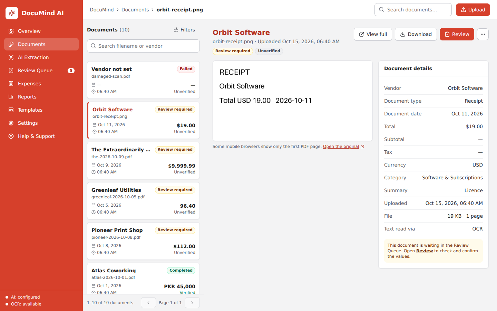
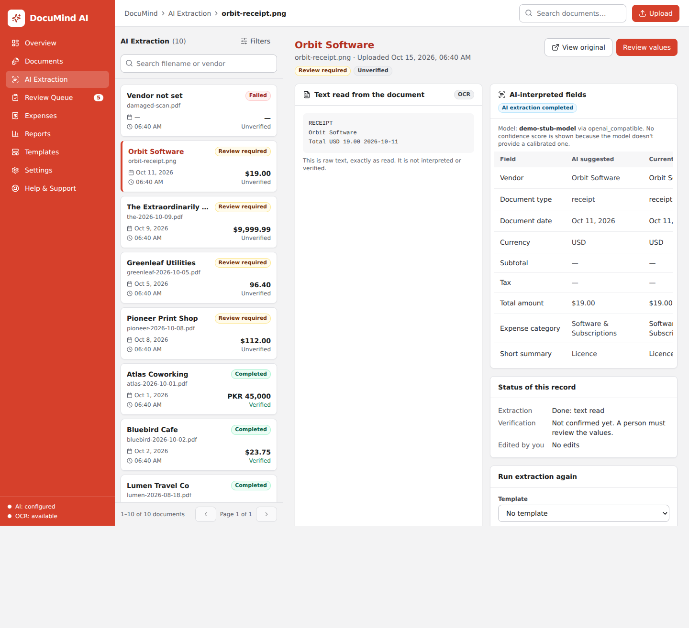
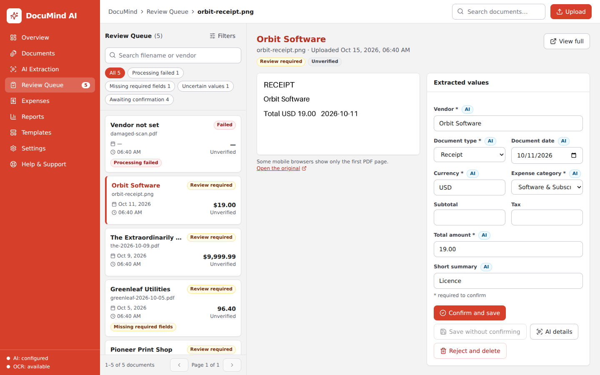
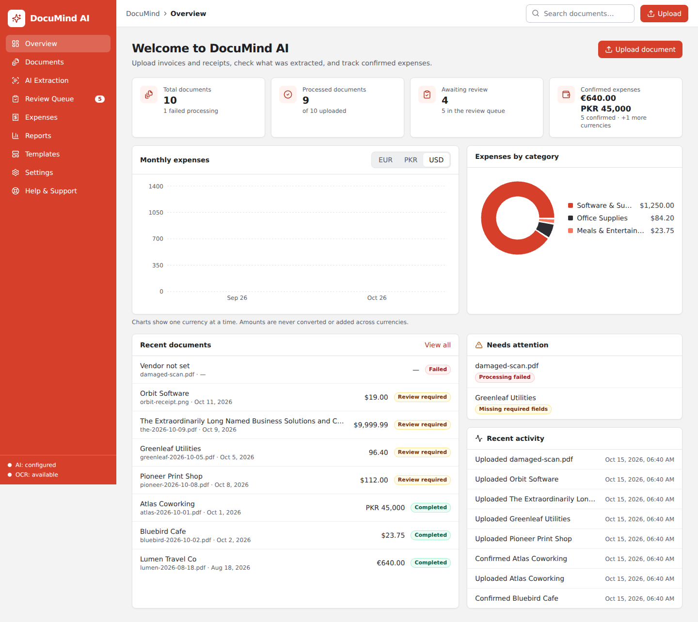
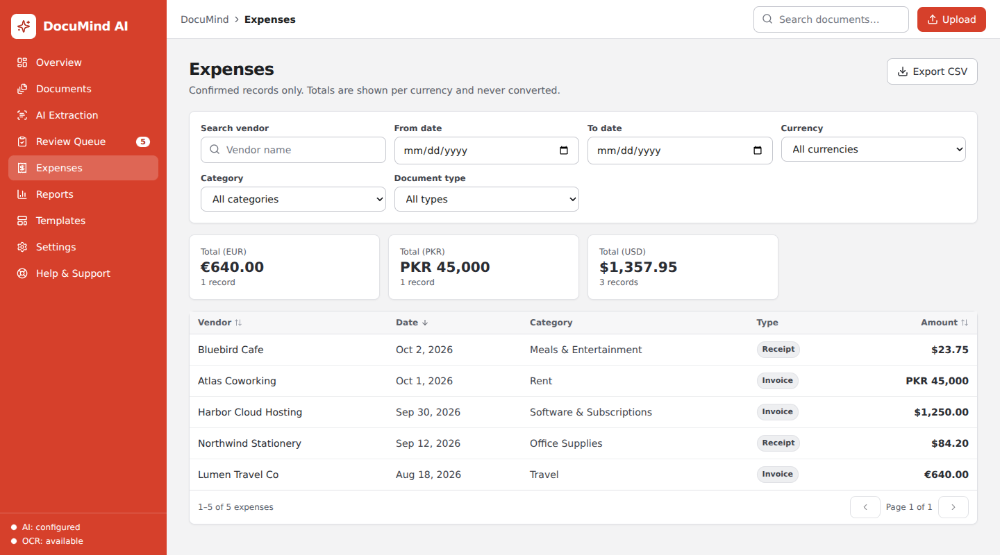
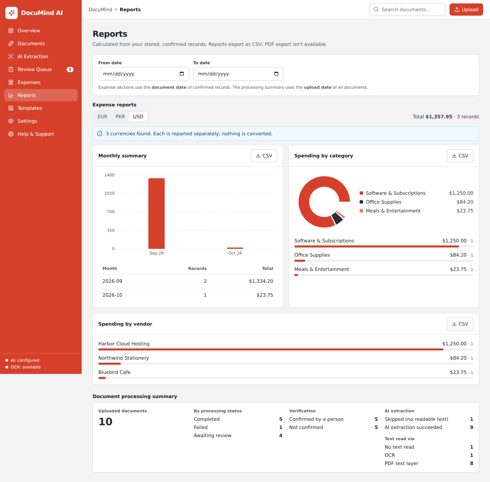
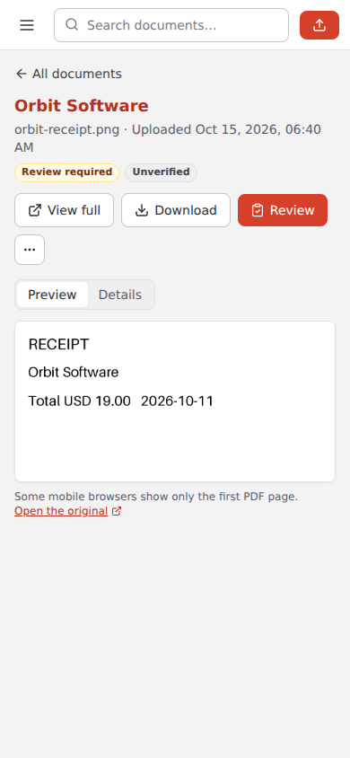
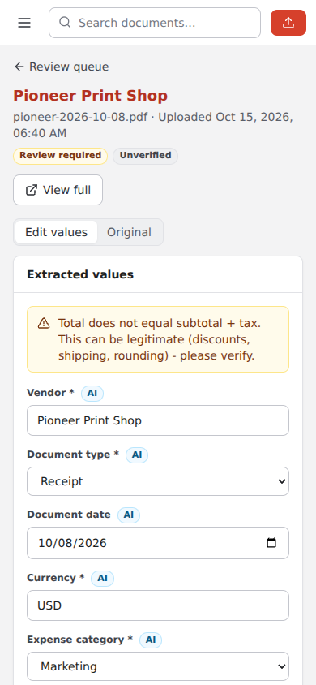
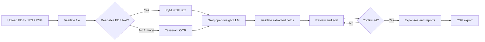
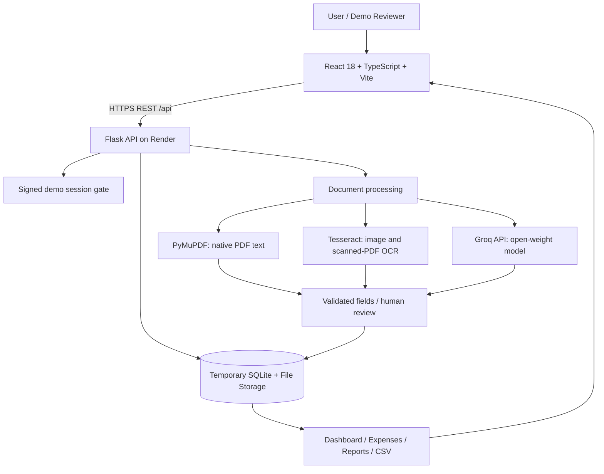

<div align="center">


### Turn receipts and invoices into organized, reviewable expense records.

**An AI-assisted document intelligence workspace for freelancers and small businesses.**

<p>
  
  
  
</p>
<p>
  
  
  
  
  
  
  
</p>

**[See the Live Demo](#live-demo) · [Features](#key-features) · [How It Works](#how-it-works) · [Architecture](#system-architecture) · [Run Locally](#local-development) · [Deploy](#deployment)**

</div>

---

## Overview

**DocuMind AI** transforms unstructured receipts, invoices, and bills into structured expense information using **PDF text extraction, OCR, and a configurable open-weight large language model**.

Rather than automatically treating an AI response as financial truth, the application puts a **human review step** between extraction and reporting. Users can inspect the original document, correct extracted values, and explicitly confirm a record before it appears in expense totals and reports.

> **Built for the DEV Community Hacktoberfest 2026 — Open-Source AI Challenge, Week 2: Side Hustle.** The current deployment is a temporary, shared-access demonstration, not a production accounting or document-storage service.

## The Problem

Freelancers and small teams often receive expense paperwork in scattered forms: scanned receipts, invoice PDFs, screenshots, and phone photos. Turning those files into a usable spreadsheet means repeatedly entering vendors, dates, amounts, currencies, and categories by hand.

Traditional OCR produces text, but **text alone is not an organized expense record**. Fully automatic AI extraction also introduces risk when a misread amount or an invented field silently enters a financial report.

## Who It's For

- **Freelancers** who want less time spent recording receipts and business expenses.
- **Solo founders and side-hustle operators** managing purchases without dedicated accounting staff.
- **Small teams** that need a reviewable document-to-CSV workflow.
- **Developers** exploring practical, provider-configurable document AI applications.

These are intended users, **not validated paying customers**.

## The Solution

DocuMind AI combines three complementary components:

1. **PyMuPDF** reads the selectable text layer from digital PDFs without unnecessary OCR.
2. **Tesseract OCR** reads scanned PDFs and JPG/PNG images when native text is missing.
3. **Groq-hosted, open-weight AI** suggests structured fields from the extracted text; server-side validators flag or reject malformed values.

The user then checks the suggestions, edits any mistakes, and confirms the record. **Only confirmed expenses enter analytics and exports.**

## Live Demo

**The Render-hosted demo has been deployed and its document workflow has been reported working by the project owner.**

> **Live application:** [Live Demo](https://documind-demo-web.onrender.com) 


**How to try it:**

1. Open the live frontend URL.
2. Enter the **shared demo access code** provided privately by the project owner.
3. Upload a **fictional/sample** receipt or invoice (PDF, PNG, or JPG).
4. Inspect extracted text and AI-suggested fields.
5. Edit/confirm the record, then view Expenses, Reports, or export a CSV.

**Demo restrictions:** files up to **3 MB**, up to **3 PDF pages**, temporary shared storage, and no real or confidential documents. The free backend may take time to wake after inactivity, and data can disappear on restart/redeploy.

## Product Screenshots

All bundled screenshots illustrate the project UI using synthetic documents. The paths below reference images already included in this repository.

| Document workspace | AI extraction |
|:---:|:---:|
|  |  |

| Review queue | Business overview |
|:---:|:---:|
|  |  |

| Confirmed expenses | Reports |
|:---:|:---:|
|  |  |

<details>
<summary><strong>Mobile screenshots</strong></summary>

| Mobile documents | Mobile review |
|:---:|:---:|
|  |  |

</details>

## Key Features

| Capability | What it does | Why it matters |
|---|---|---|
| **Document upload** | Supports PDF, PNG, and JPG, with size/type/content checks | Safer, simpler document intake |
| **Hybrid text extraction** | PyMuPDF for native text; Tesseract for scanned/image documents | Handles both digital and photographed paperwork |
| **AI-assisted structuring** | Suggests vendor, date, currency, totals, tax, category, and summary | Reduces repetitive manual entry |
| **Human-in-the-loop review** | Side-by-side original, raw text, suggestions, and editable fields | Prevents unreviewed values from changing totals |
| **Field provenance** | Labels values as **AI**, **Template**, or **You** | Makes the origin of each value visible |
| **Review queue** | Shows pending, incomplete, or failed records; supports edit, retry, confirm, and reject | Keeps unresolved documents actionable |
| **Extraction templates** | Selects expected fields and default categories | Helps repeat common document workflows |
| **Expense management** | Filters, search, sorting, pagination, and per-currency totals | Turns approved documents into records |
| **Reporting and CSV** | Monthly, vendor, and category summaries; CSV export | Makes information usable outside the app |
| **Demo access gate** | Shared access code and expiring signed session | Reduces casual access to the public demo; **not** per-user authentication |
| **Responsive UI** | Dedicated views for desktop and smaller screens | Supports different devices |

### What gets extracted?

The extraction contract includes the following fields:

```json
{
  "document_type": "receipt",
  "vendor": "Example Stationery Store",
  "document_date": "2026-10-18",
  "currency": "PKR",
  "subtotal": "5500.00",
  "tax": "500.00",
  "total_amount": "6000.00",
  "expense_category": "Office Supplies",
  "short_summary": "Stationery and office equipment purchase"
}
```

*Illustrative synthetic example — not a claim that an AI model returned these exact values. Missing or invalid suggestions can remain empty until reviewed.*

## How It Works



**Important design choice:** AI proposes; the user approves. Documents with AI errors can still be reviewed manually rather than being silently marked as successful.

## System Architecture



- The **frontend** never receives the Groq API key.
- The **Flask backend** handles uploads, storage, extraction, review, and reporting.
- The **Docker image** installs Tesseract on the hosting server; there is **no production OCR installation requirement on the developer's laptop**.
- In the **free demo**, SQLite and uploaded files are **ephemeral**, not durable production storage.
- Financial records are **never converted between currencies**; summaries keep currencies separate.

### Tech Stack

| Layer | Technology |
|---|---|
| UI | React 18, TypeScript, Vite, Tailwind CSS, Lucide React, Recharts |
| Backend API | Python 3.12, Flask, Flask-CORS, Gunicorn |
| Data access | SQLAlchemy |
| PDF parsing | PyMuPDF |
| Optical character recognition | Tesseract OCR, pytesseract, Pillow |
| LLM inference | GroqCloud OpenAI-compatible API; configurable model ID |
| Default demo model | `openai/gpt-oss-20b` in `render-free.yaml` (availability may change) |
| Demo persistence | SQLite + temporary filesystem |
| Production-oriented configuration | PostgreSQL + persistent upload disk (**paid**, separate Blueprint) |
| Hosting | Render Static Site + Docker Web Service |
| Tests | pytest, Vitest, Testing Library; browser smoke-test tooling |

### Repository Layout

```text
DocuMind-AI/
├── backend/
│   ├── app/
│   │   ├── services/           # PDF/OCR/AI/storage/processing
│   │   ├── demo_auth.py        # Shared-code demo access gate
│   │   ├── routes.py           # API and document workflows
│   │   ├── routes_reports.py   # Analytics and CSV
│   │   ├── routes_templates.py # Extraction templates
│   │   └── config.py           # Environment configuration
│   ├── tests/                 # Backend regression tests
│   ├── Dockerfile             # Installs server-side Tesseract
│   └── requirements.txt
├── frontend/
│   ├── src/
│   │   ├── components/        # Upload, preview, review, demo gate
│   │   ├── pages/             # Nine application screens
│   │   ├── api.ts             # Flask API client
│   │   └── App.tsx
│   └── package.json
├── docs/
│   ├── screenshots/
│   ├── FREE_DEMO_DEPLOYMENT.md
│   ├── DEPLOYMENT.md
│   └── VALIDATION.md
├── render-free.yaml          # Free, nonpersistent demo Blueprint
├── render.yaml               # Separate PAID persistent Blueprint
├── .env.example
└── README.md
```

## Local Development

> The hosted demo does **not** require installing Tesseract on your personal computer. Local OCR testing only requires Tesseract if you want to process scanned PDFs/images **locally**; the deployed Docker image installs it automatically.

**Prerequisites:** Python 3.12 (the version used by the Docker image), Node.js 22 (the deployment build version), npm, and an optional Groq API key for real local AI inference.

### 1. Start the backend

From the repository root, on **Windows PowerShell**:

```powershell
cd backend
python -m venv .venv
.\.venv\Scripts\Activate.ps1
python -m pip install -r requirements-dev.txt
cd ..
Copy-Item .env.example .env
```

Edit the newly created `.env` for local development. At minimum, change the production defaults to:

```dotenv
APP_ENV=development
DATABASE_URL=sqlite:///data/documind.db
UPLOAD_DIR=data/uploads
CORS_ORIGINS=http://localhost:5173
GROQ_API_KEY=your_key_if_using_ai
AI_PROVIDER=groq
AI_BASE_URL=https://api.groq.com/openai/v1
AI_MODEL=openai/gpt-oss-20b
```

Then start Flask:

```powershell
cd backend
python run.py
```

Health endpoint: `http://127.0.0.1:5000/api/health`

### 2. Start the frontend

Open a **second terminal** from the repository root:

```powershell
cd frontend
npm ci
npm run dev
```

Open `http://localhost:5173`. The Vite development server proxies API calls to Flask. If no Groq key is available, upload/review can still be used with manual field entry in development mode; scanned-image processing still needs locally available OCR.

### 3. Run the tests

```powershell
# From the backend directory, with dependencies installed
python -m pytest -q
```

```powershell
# From the frontend directory
npm run build
npm test
```

The repository's [`docs/VALIDATION.md`](docs/VALIDATION.md) records **110 passed, 1 skipped** for backend tests in an earlier preparation run, plus frontend build and UI integration test results. Those tests used simulated AI responses; they do **not** establish a measured accuracy score or independently verify your hosted Groq account.

## Deployment

There are **two intentionally separate Render configurations**:

| Configuration | Intended use | Persistence | Hosting cost |
|---|---|---|---|
| [`render-free.yaml`](render-free.yaml) | Hacktoberfest demonstration | **Ephemeral SQLite + files** | Free-tier target, subject to provider limits |
| [`render.yaml`](render.yaml) | Persistent deployment planning | PostgreSQL + persistent upload disk | **Paid resources** |

### Free Demo — Recommended for Reviewers

1. Push the repository to GitHub.
2. In Render, select **New → Blueprint** and explicitly choose **`render-free.yaml`**.
3. Confirm the services are `documind-demo-api` (**Free Web Service**) and `documind-demo-web` (**Static Site**) — with no paid database or disk.
4. Enter `DEMO_ACCESS_CODE` (private, **16+ characters**), `GROQ_API_KEY`, and the exact frontend HTTPS origin in `CORS_ORIGINS`.
5. Set the frontend's `VITE_API_BASE_URL` to the **actual backend URL** (without an `/api` suffix). Render automatically generates `DEMO_SIGNING_SECRET`.
6. Wait for both deployments, then test `/api/health`, unlock the demo, upload synthetic documents, review the extraction, and export a CSV.

**Full instructions and troubleshooting:** [`docs/FREE_DEMO_DEPLOYMENT.md`](docs/FREE_DEMO_DEPLOYMENT.md).

> **Free-tier caveats:** possible cold starts, API rate limits, OCR memory constraints, and loss of all SQLite records/uploads on restart or redeploy. Pricing and allocations can change. Check the Render confirmation screen before accepting any paid resources.

## API Overview

| Endpoint | Purpose |
|---|---|
| `GET /api/health` | Public health, database, OCR, and AI-configuration indicators |
| `POST /api/demo/unlock` | Exchange the private demo access code for a signed session |
| `GET /api/documents` | Browse/filter uploaded documents |
| `POST /api/documents/upload` | Upload and process a document |
| `POST /api/documents/<id>/confirm` | Confirm edited/extracted fields |
| `GET /api/review/queue` | View documents needing human review |
| `GET /api/dashboard` | Overview data |
| `GET /api/reports/summary` | Report summaries |
| `GET /api/export/csv` | Export expense records |

In demo mode, all document/data endpoints except `/api/health` and the access-code exchange require a valid bearer session token. See backend route modules for the full API contract.

## Validation & Current Status

| Area | Status | Evidence / boundary |
|---|---|---|
| React frontend | **Deployed; reported working** | Project owner confirmed the page and workflow worked |
| Flask API | **Deployed; health check returned OK** | Database, OCR availability and AI configuration reported OK |
| OCR + AI extraction | **Reported working in live demo** | Sample receipt tested by the project owner; no measured accuracy benchmark |
| Backend automated tests | **Previously recorded** | 110 passed, 1 skipped in [`docs/VALIDATION.md`](docs/VALIDATION.md) |
| Frontend tests/build | **Previously recorded** | Build and UI tests documented in [`docs/VALIDATION.md`](docs/VALIDATION.md) |
| Production security/scalability | **Not established** | Shared-access demo, synchronous processing, ephemeral storage |

The public health endpoint being healthy is **not by itself proof** that every extraction is correct. Financial fields should always be reviewed.

## Security, Privacy & Limitations

- **Shared demo, not user accounts.** Anyone using the same code shares the same workspace and can access its stored demo documents. The access code must **never** appear in this README or the GitHub repository.
- **Use synthetic documents only.** Do not upload real customer invoices, personal information, or confidential financial records.
- **Third-party inference.** Extracted document text is sent to the configured AI provider (currently Groq); this is **not a fully offline/private inference stack**.
- **Ephemeral data.** The free Render filesystem is temporary; records and uploads can disappear without recovery. No backups or durability guarantees are provided.
- **Resource limits.** AI/OCR run in the upload request, and large scans can time out or exhaust low-tier resources. The demo limits upload size, pages, OCR resolution, and concurrent processing.
- **AI is fallible.** No calibrated extraction confidence or production accuracy score is claimed. Required fields and formats are validated, but user confirmation remains essential.
- **Reporting scope.** CSV export is supported; PDF report export, automatic FX conversion, bulk uploads, and independent multi-user workspaces are not implemented.
- **Financial scope.** This is document/expense assistance, **not** certified bookkeeping, tax advice, or an accounting system.

## Side-Hustle Potential

DocuMind AI explores a straightforward business hypothesis: **freelancers and microbusinesses may pay to spend less time entering receipts while retaining control over every number**.

Possible future offerings include a hosted subscription, a setup-and-automation service for small firms, or integrations with existing bookkeeping workflows. **These are ideas, not launched plans or validated revenue claims.**

### Roadmap

- [ ] Separate user accounts, roles, and document isolation
- [ ] Persistent managed database and object storage
- [ ] Asynchronous processing and job queue
- [ ] Duplicate detection and item-level extraction
- [ ] Bulk upload and integrations with bookkeeping tools
- [ ] Reproducible document-extraction accuracy benchmark
- [ ] Multi-currency conversion with a documented exchange-rate source
- [ ] PDF reports, audit history, and retention policies

## Contributing

Contributions, bug reports, and feature suggestions are welcome through GitHub issues and pull requests. For any change involving document extraction, privacy, or financial totals, include a test or clear reproduction steps.

**Licensing:** The current repository package does not include a `LICENSE` file. Choose and add an explicit license before describing the repository as MIT-licensed or making redistribution permissions claims.

## Author & Acknowledgements

**Imran Ghafoor** — AI / Machine Learning developer  
[GitHub Profile](https://github.com/Imran-Ghafoor594) · [Portfolio](https://imranghafoor.vercel.app/)

Built with React, Flask, PyMuPDF, Tesseract, SQLAlchemy, Groq-compatible inference, and Render. Developed as a practical **Hacktoberfest 2026 Side Hustle** prototype.

<div align="center">


*Extract smarter. Review confidently. Stay in control.*

</div>
